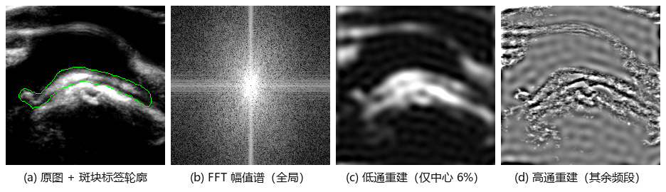
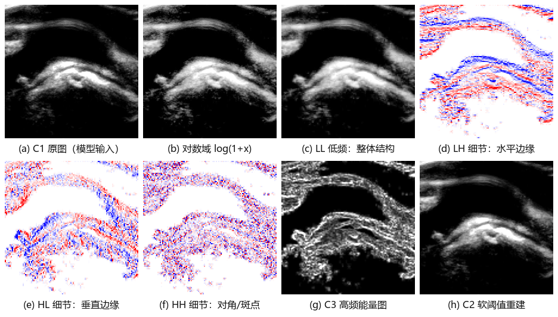
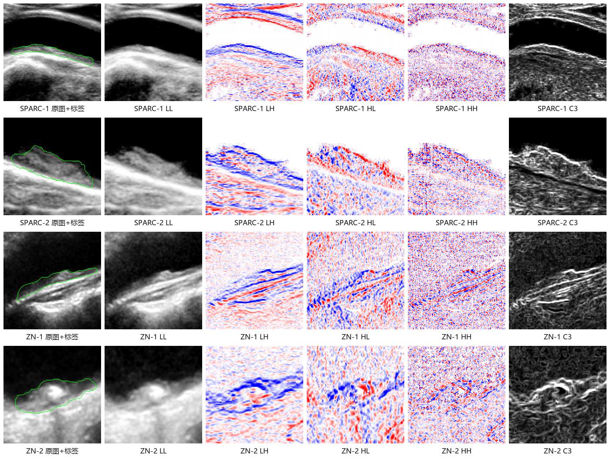
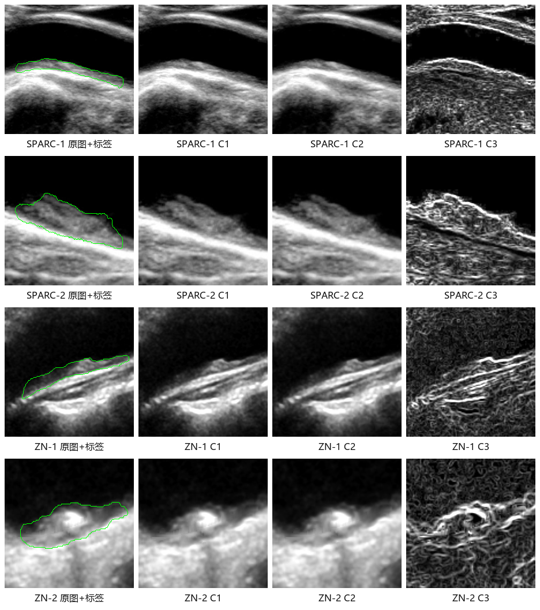

# 颈动脉超声图像类型入门：B 型图、频域、小波与高低频

> 目的：把「傅里叶 / 小波 / 低频 / 高频 / 原图 / 去噪重建图 / 高频能量图」这些词对应到**你眼睛能看到的图**，以及它们在本项目里各自做什么。
> 读完应能回答：一张小波分解图里哪块是边界、哪块是噪声、为什么高频能量图能帮分割、为什么不用 FFT 当输入。

---

## 0. 一句话版本

- **B 型超声图**：一张灰度图，亮度 = 回波强弱。
- **低频 / 高频**：指**图像内亮度变化的快慢**（空间频率），不是探头的工作频率。
- **傅里叶变换**：把整张图拆成「各种粗细的条纹」，告诉你「有哪些频率」，但**不告诉你频率在哪**。
- **小波变换**：把图拆成「低频大结构 + 三个方向的高频细节」，而且**保留位置**，所以能直接当分割网络的输入。
- **三张派生图**：本项目从同一张原图派生出的三张图——原图通道（归一化后的原始 B 型图）、去噪重建通道（对数域软阈值后逆变换重建、再拉回原图均值方差的那张图）、高频能量通道（三张细节子带平方和开方得到的能量图）。

---

## 1. 先认识原始图：B 型超声

本项目用的是**颈动脉 B 型（B-mode）灰阶超声**，2D 切片，二值标签标出斑块区域。

### 1.1 一张 B 型图里各部分的含义

| 视觉表现 | 组织含义 | 在分割中的角色 |
|---|---|---|
| 黑色、几乎无回声的管状区 | 血管腔内的血液 | 通常不是斑块，是重要的对照结构 |
| 中等灰度的增厚区 | 血管壁 / 斑块（脂质、纤维组织） | **前景目标** |
| 很亮的白斑，后面拖一条黑带 | 钙化 + 后方声影 | 斑块的一部分，但边界常被声影破坏 |
| 细密的颗粒状纹理 | 斑点噪声（speckle） | 干扰项，不是解剖结构 |
| 整体忽明忽暗 | 设备增益、探头角度、近远场差异 | 域偏移来源，换中心就可能掉点 |

### 1.2 为什么这张图难分

1. **边界弱**：斑块与管腔、斑块与外膜之间的灰度差可能只有几个灰阶。
2. **斑点噪声是乘性的**：它不是「加一点随机数」，而是跟信号强度绑在一起，直接平滑会把边界一起糊掉。
3. **声影**：钙化后面的组织直接没信号，任何模型都只能猜。
4. **设备差异**：不同中心、不同机器的增益曲线不同，同一块斑块可以呈现出完全不同的亮度分布。

这三条正好解释了项目为什么要做**对数域 + 小波 + 高频能量图**（见第 5 节）。

### 1.3 本文不涉及的图像类型

| 类型 | 显示内容 | 本项目 |
|---|---|---|
| B 型灰阶 | 组织结构 | **使用** |
| 彩色多普勒 | 血流方向与速度 | 不用 |
| 频谱多普勒（PW） | 流速随时间变化的波形 | 不用 |
| 弹性成像 | 组织硬度 | 不用 |
| 超声造影（CEUS） | 新生血管 / 灌注 | 不用 |

数据里每张 `.nii.gz` 就是一张 B 型灰度切片，标签是同名 `_label.nii.gz`，前景为斑块。

---

## 2. 「低频 / 高频」到底指什么

这是最容易混的一个点：

- **探头频率**（例如 5–12 MHz）是物理超声波的频率，决定穿透深度和分辨率。
- **空间频率**（本文所说的低频 / 高频）是**图像平面上亮度变化的快慢**，单位是「周期 / 像素」。

同一个词，两个维度。本文后面一律指**空间频率**。

### 2.1 直观理解

```
空间频率：   低 ──────────────────────────────────────────► 高
典型内容：   管腔/斑块的整块灰度     斑块边界      钙化边缘      斑点噪声
变化速度：   缓慢                   较快          很快          逐像素跳变
```

- **低频**：一块区域内亮度差不多，比如管腔内部、斑块内部。
- **中频**：几个像素内完成的明暗过渡，比如斑块边界。
- **高频**：一个像素到下一个像素就变，比如钙化边缘、斑点噪声。

### 2.2 关键结论

> **边界一定包含高频，但高频不全是边界。**

这句话决定了高频能量图的定位：它会同时点亮「边界」和「斑点噪声」，网络要学的是从中挑出前者。它不是一张干净的边缘图。

---

## 3. 傅里叶变换：知道「有哪些频率」，不知道「在哪」

### 3.1 它做了什么

二维离散傅里叶变换把图像 `f(x,y)` 写成无数个不同方向、不同粗细的正弦条纹的叠加：

```
F(u,v) = Σ_x Σ_y f(x,y) · exp(-j2π(ux/M + vy/N))
```

- `|F(u,v)|` 是**幅值谱**：某个频率成分有多强。
- `∠F(u,v)` 是**相位**：这些条纹往哪边挪。
- 中心是低频，越往外频率越高。

图里通常只画 `log(1+|F|)`，因为低频能量比高频大好几个数量级，不取对数什么都看不见。



- (a) 原图，绿线是斑块标签轮廓。
- (b) 幅值谱：亮点集中在中心（低频占绝大多数能量），十字亮线来自图像边界和扫描区域的强直线结构。
- (c) 只保留中心 6% 的低频再逆变换：整体轮廓还在，但边界全糊。
- (d) 只保留外围高频：只剩下边缘和斑点，灰度结构消失。

### 3.2 为什么不能直接把 FFT 当输入通道

这是项目里的明确决策（见 [technical-design.md](file:///f:/code/MyPython/TransUNet/docs/technical-design.md#L27-L33) 的「预处理：Haar DWT（1 级）」一节）：

1. **没有空间定位**：频谱里一个点代表「全图都在以这个频率振动」，你无法回答「这个边界在左上还是右下」。
2. **相位难对齐**：幅值谱丢相位；保留复数又对几像素的平移极其敏感，而超声探头每次扫的角度都不一样。
3. **全局性**：斑块只占图像一小块，它的高频会被全身其他结构稀释。
4. **不可解释**：网络从复数谱里学到的权重，没法对应回解剖结构。

### 3.3 那 FFT 在项目里还有位置吗

有，但只是**备选**（见 [technical-design.md](file:///f:/code/MyPython/TransUNet/docs/technical-design.md#L107-L111) 的「其他频域手段」一节）：

```
特征 → FFT → 1×1 可学习复数权重 → IFFT → 特征
```

这叫「频域滤波层」，参数量极小，放在 bottleneck 或 skip 上。它保留空间尺寸，只是换到频域做一次加权。**当前不进实验队列**。

---

## 4. 小波变换：既有频率，又有位置

### 4.1 核心区别

| | 傅里叶 | 小波 |
|---|---|---|
| 基函数 | 无限长的正弦波 | 有限长、会衰减的小波 |
| 定位 | 全局，无位置 | **局部**，知道在哪个位置 |
| 输出 | 一张频谱 | 多张子带图（每张保留空间布局） |
| 适合 | 平稳信号、全局纹理 | **图像**：边界、局部结构、多尺度 |

一句话：**傅里叶告诉你「有什么」，小波告诉你「在哪里有什么」。**

### 4.2 Haar 小波：项目实际用的版本

项目没有引入 `pywt`，而是用 4 个固定的 2×2 卷积核手写（[wavelet.py](file:///f:/code/MyPython/TransUNet/networks/wavelet.py#L8-L28)）。对每个 2×2 小块：

```
a b
c d
```

```
LL = 0.5(a + b + c + d)      # 四个一起求和再乘 0.5 → 低频近似
LH = 0.5(a + b - c - d)      # 上下两行之差 → 垂直方向变化（水平边缘）
HL = 0.5(a - b + c - d)      # 左右两列之差 → 水平方向变化（垂直边缘）
HH = 0.5(a - b - c + d)      # 对角之差 → 对角纹理 / 斑点
```

四个核都是**无参数、可逆**的：知道低频近似子带和水平、垂直、对角三张方向子带，就能原样重建回原图（[wavelet.py](file:///f:/code/MyPython/TransUNet/networks/wavelet.py#L31-L35)）。

> 命名约定不统一：有的文献把水平方向子带与垂直方向子带的方向说反。**以「对哪一维做差」为准**，不要死记字母。

因为每个 2×2 块只输出一个值，1 级分解后每张子带图的尺寸是原图的 **1/2 × 1/2**（224 → 112）。

### 4.3 四张子带图分别长什么样



这张图来自真实数据（SPARC 子集，`171757_01-22-2014/171757_01-22-20140001.nii.gz`），流程与 `build_three_channel` 完全一致：

| 面板 | 是什么 | 你应该看到 |
|---|---|---|
| (a) 原图通道 | 归一化后的原图 | 管腔黑、斑块中等灰度、钙化亮 |
| (b) 对数域 | `log(1+x)` 后的图 | 暗部细节被抬亮，动态范围被压缩 |
| (c) 低频近似子带（LL） | 低频近似，尺寸 112×112 | 原图的「缩略图」，大结构都在，边界略软 |
| (d) 水平方向子带（LH） | 行方向差分 | 水平走向的边缘；红/蓝表示差值的正负 |
| (e) 垂直方向子带（HL） | 列方向差分 | 垂直走向的边缘；红/蓝表示差值的正负 |
| (f) 对角方向子带（HH） | 对角差分 | 对角纹理、斑点噪声，管腔内接近白（0） |
| (g) 高频能量通道 | `sqrt(LH²+HL²+HH²)` 再标准化 | 边界和钙化处亮，管腔内暗 |
| (h) 去噪重建通道 | 软阈值后逆变换 | 比原图平滑，斑点被压掉，边界仍在 |

**彩色不是「RGB 三个通道」**。水平、垂直、对角三张方向子带里是有符号的细节系数，红 = 正、蓝 = 负、白 = 接近 0。它表示的是一阶明暗变化的方向，不是颜色信息。

### 4.4 多病例对照：同一套操作，不同的斑块形态

单张图容易让人以为「小波分解就长这样」。下面是两个中心、四个病例的同流程输出（生成方式与 `build_three_channel` 完全一致）：



| 编号 | 子集 | 文件 | 原图尺寸 | 标签像素占比 |
|---|---|---|---|---|
| SPARC-1 | SPARC | `107726_02-17-2015/107726_02-17-20150006(2).nii.gz` | 260×390 | 6.0% |
| SPARC-2 | SPARC | `227048_03-19-2019/227048_03-19-20190001.nii.gz` | 152×229 | 17.9% |
| ZN-1 | Zhongnan | `0186/0186_5.nii.gz` | 204×306 | 7.9% |
| ZN-2 | Zhongnan | `0264/0264_4.nii.gz` | 127×191 | 18.0% |

看图时注意四点：

1. **低频近似子带始终像一张缩略图**：斑块、管腔、钙化都还在，只是分辨率减半。它不负责「找边界」。
2. **水平方向子带与垂直方向子带在斑块边界处成对出现红蓝**：一侧亮、一侧暗，说明这里有一次明暗跃变。没有跃变的地方接近白色。
3. **对角方向子带对钙化和斑点最敏感**：ZN-2 的钙化点在对角方向子带里非常亮，但周围的斑点也一样亮，所以高频能量图不能区分「钙化边界」和「噪声」。
4. **不同中心的纹理差异很大**：Zhongnan 的图整体斑点更密，高频能量图的背景也更花。这正是项目要按中心分开训练、分开报告的原因。

### 4.5 多级分解

对低频近似子带再分解一次就是 2 级：

```
1 级：原图 → LL1 + (LH1, HL1, HH1)         尺寸 1/2
2 级：LL1  → LL2 + (LH2, HL2, HH2)         尺寸 1/4
```

- **1 级高频**：主要对应边界 + **斑点噪声**。
- **2 级高频**：尺度更大，更接近「斑块轮廓」，斑点相对少。
- 3 级以上：在超声里基本只剩斑点，没有解剖意义。

项目当前**只用 1 级**；2 级只是备选实验（[experiments.md](file:///f:/code/MyPython/TransUNet/docs/experiments.md#L66-L72) 中「小波级数 1 vs 2」一项），用来把「斑点」和「边界」分到不同尺度。

---

## 5. 项目里的三张图：原图、去噪重建图、高频能量图

代码入口：[build_three_channel()](file:///f:/code/MyPython/TransUNet/networks/wavelet.py#L58-L90)。输入是已归一化的 `(B,1,224,224)`，输出 `(B,3,224,224)`。

```text
x (B,1,224,224)
│
├─ 原图通道 = x                              （主路径第一路）
│
└─ 对数域 xl = log(1 + (x - min + 1e-3))
   │
   ├─ Haar DWT → 低频近似 + 三张方向子带（各 112×112）
   │  │
   │  ├─ 去噪重建通道 = expm1(IDWT(低频, 软阈值(三张方向子带)))   （仅消融）
   │  │
   │  └─ 高频能量通道 = zscore(sqrt(水平²+垂直²+对角²)) ↑224      （主路径第二路）
   │
   └─ 输出 [原图通道, 去噪重建通道, 高频能量通道]
```

### 5.1 为什么要先取对数

超声斑点噪声近似**乘性**：`观测 = 真实 × 噪声`。取对数后变成 `log 观测 = log 真实 + log 噪声`，加性噪声才能用小波阈值处理。同时 `log1p` 压缩动态范围，让暗部（管腔、斑块内部）的细节不被亮部（钙化）压死。

### 5.2 去噪重建图：软阈值去噪重建

```text
σ = median(|detail|) / 0.6745
T = σ · sqrt(2 ln N)
soft(x) = sign(x) · max(|x| - T, 0)
```

- `σ` 用中位数绝对偏差（MAD）估计噪声强度，`N` 是细节系数总数。
- 小于阈值的系数被压到 0（认为是噪声），大于阈值的整体收缩（保留但减弱）。
- 这就是经典的 **VisuShrink**，阈值规则见 [visushrink_threshold()](file:///f:/code/MyPython/TransUNet/networks/wavelet.py#L43-L49)。

**去噪重建通道为什么只做消融、不进主路径**（[technical-design.md](file:///f:/code/MyPython/TransUNet/docs/technical-design.md#L33-L47)）：

- 它是「替换原图」的思路，而文献里输入级去噪的收益不稳定，常常为负。
- 去噪会把斑块内部的弱纹理一起抹掉，而弱纹理有时正是分型依据。
- 把去噪图塞进分割网络，等于让网络吃一份已经被别人做过决策的输入。

### 5.3 高频能量图：三张子带的能量合成

```text
E = sqrt(水平² + 垂直² + 对角²)   # 三个方向的高频强度合成
E = zscore(E)                      # 逐样本减均值除标准差
高频能量图 = bilinear_upsample(E, 224)
```

要点：

1. **它是能量，不是灰度**：`E` 只回答「这里变化有多剧烈」，不区分是边界还是噪声。
2. **三个方向合成后丢掉了方向**：水平、垂直、对角三张方向子带的符号和方向信息在平方求和后消失。这是高频能量图的已知损失，也是双骨干交错四级融合方案（主路吃原图，侧路吃三张方向子带，四个接点逐级融合）想改用「三方向子带分别作通道」的原因。
3. **z-score 之后不再有绝对幅度**：所以「把高频能量图乘一个系数 λ 来增强高频」是**无效操作**，会被标准化抵消（[experiments.md](file:///f:/code/MyPython/TransUNet/docs/experiments.md#L72)）。
4. **为什么要上采样回 224**：1 级 DWT 输出是 112×112，而网络输入和 skip 连接都按 224 对齐；不补回来，尺度层级会对不上。

### 5.4 三张图在项目里的去留

| 通道 | 内容 | 当前定位 | 状态 |
|---|---|---|---|
| **原图通道** | 归一化原图 | 主路径第一路，必需 | ✅ |
| 去噪重建通道 | 软阈值去噪重建 | 只做消融（三通道早融合、三通道＋小波引导注意力） | ✅ 已跑，不进主路径 |
| **高频能量通道** | 高频能量 | 主路径第二路 | ✅ |

当前代码仍然输出三通道（依次为原图、去噪重建图、高频能量图）；主路径要用的「原图 + 高频能量图」布局开关（`layout="c1c3"`，第三通道补零）还**没实现**，见 [technical-design.md](file:///f:/code/MyPython/TransUNet/docs/technical-design.md#L34-L67) 的「三通道构造」与「代码改动清单」两节。

> 补零不是凑数：ViT 的 patch embedding 固定 3 通道，`[原图, 高频能量图, 零]` 既保留了预训练权重，又明确告诉网络第三通道没有信息。

### 5.5 多病例三通道对照



每行一个病例，四列依次是「原图 + 标签轮廓 / 原图通道 / 去噪重建通道 / 高频能量通道」。四个病例与 4.4 节相同。

重点观察：

1. **原图通道和原图几乎一样**：它只是做了 1%–99% 截断、z-score 和缩放，没有改变结构。
2. **去噪重建通道的变化很细微**：斑点被压低、斑块内部纹理变软，但边界仍在。放大看才会发现它比原图通道「干净」，这也是它单独做通道收益不稳定的原因。
3. **高频能量图和原图完全不是一回事**：原图亮的地方高频能量图不一定亮（比如管腔内部均匀发黑，高频能量图很暗，z-score 后为负）；高频能量图亮的地方是「明暗变化剧烈」的地方。
4. **小斑块 vs 大斑块**：SPARC-1、ZN-1 的高频能量图主要集中在斑块边界；SPARC-2、ZN-2 的大斑块内部异质性也被高频能量图放大，亮区更宽、更碎。
5. **高频能量图不能单独当分割图**：它没有「这是斑块」的语义，只回答「这里变化强不强」。语义仍然要靠原图 + 编码器来提供，这也是双输入而不是只输入高频能量图的原因。

---

## 6. 这些图怎么进入网络

当前主方法（共享权重双输入）的完整链路：

```text
                     ┌─ 原图通道 ───────────────┐
原图 x ─ 预处理 ──────┤                          ├─ 同一套 R50+ViT ─ 跨支门控 ─ U-Net 解码 ─ 四指标
                     └─ 高频能量通道 ───────────┘
                        去噪重建通道只用于消融

原图通道看「灰度长什么样」，高频能量通道看「哪里在快速变化」。
两路输入不同，融合才有信息可交换；如果两路都喂高频能量图，就是三通道＋小波引导注意力（旧版，只在 14×14 单点融合）失败的原因。
```

对应的实验编号（详见 [experiments.md](file:///f:/code/MyPython/TransUNet/docs/experiments.md#L36-L62)）：

- **E1**：原图通道 + 高频能量通道双通道早融合，单编码器、无注意力。
- **E2**：共享权重双输入 + 跨支门控，只融深层 28×28。
- **E3**：共享权重双输入 + 拼接回投影对照，用来区分「注意力」和「多一路特征」。
- **E4**：共享权重双输入 + 跨支门控，112×112、56×56、28×28 三级全开。

---

## 7. 常见误解

| 误解 | 事实 |
|---|---|
| 「低频图就是高斯模糊图」 | 低频近似子带是**下采样后的近似**，尺寸只有一半；它保留大结构，但不像高斯模糊那样原地保留分辨率 |
| 「高频就是噪声」 | 边界、钙化边缘也在高频；高频能量图在斑块边界处同样很亮 |
| 「小波分解图是一张彩色图」 | 是四张子带图；红蓝是**系数的正负**，不是颜色通道 |
| 「高频能量图是增强后的原图」 | 高频能量图是 z-score 后的能量图，均值为 0，和原图通道的灰度不可直接比较 |
| 「把高频能量图乘个系数就能增强高频」 | 逐样本 z-score 会把常数缩放抵消，必须换尺度或换通道构成 |
| 「FFT 比小波更高级」 | 两者是不同工具：FFT 全局、无定位；小波局部、多尺度。图像任务默认选小波 |
| 「小波级数越多越好」 | 3 级以上在超声里基本是斑点，1–2 级足够 |
| 「低频/高频 = 探头频率」 | 本文指空间频率；探头频率是物理超声频率，两件事 |
| 「去噪重建图更干净，主路径应该用它」 | 去噪收益不稳定，且会抹掉斑块内部纹理；去噪重建通道只做消融 |

---

## 8. 拿到一张新图，怎么自检

按顺序看这 5 件事，基本能判断预处理有没有出问题：

1. **原图通道**：管腔是否接近全黑？斑块是否还能看出内部灰度层次？如果整张图发灰或过曝，检查 1%–99% 截断和 z-score。
2. **低频近似子带**：斑块轮廓是否还能认出来？如果低频近似子带里斑块已经和周围融成一片，说明尺度选大了或输入被过度平滑。
3. **水平方向子带 / 垂直方向子带**：斑块边界处是否出现**成对的红蓝条纹**（一侧亮、一侧暗）？只有一边或颜色很乱，可能是方向命名看反了，或边界本身太弱。
4. **对角方向子带**：管腔内是否接近白色（系数≈0）？钙化处是否最亮？如果管腔里也很花，说明斑点噪声很强，高频能量图会被噪声主导。
5. **高频能量图**：亮的地方是否集中在「边界 + 钙化」？如果整张图均匀发亮，说明高频被噪声铺满，这张高频能量图对分割帮助有限。

---

## 9. 术语速查

| 术语 | 含义 | 本项目对应 |
|---|---|---|
| B-mode | 灰阶超声，亮度表示回波强度 | 数据本体 |
| Speckle | 斑点噪声，乘性、颗粒状 | 需要抑制的干扰 |
| 空间频率 | 图像亮度变化的快慢 | 本文「低频/高频」 |
| DFT / FFT | 离散傅里叶变换，全局频谱 | 仅作频域滤波层备选 |
| 幅值谱 / 相位 | 频率强度 / 条纹位置 | 可视化只看幅值 |
| DWT | 离散小波变换 | Haar 1 级 |
| 低频近似子带（LL） | 小波分解的低频近似 | 不直接进网络 |
| 水平 / 垂直 / 对角方向子带（LH / HL / HH） | 三个方向的高频细节子带 | 合成高频能量图；双骨干交错四级融合方案计划分别作通道 |
| 软阈值 | `sign(x)·max(|x|-T,0)` | 去噪重建通道的去噪步骤 |
| VisuShrink | 基于 MAD 的通用小波阈值 | `T = σ√(2lnN)` |
| 高频能量 | `√(LH²+HL²+HH²)` | 高频能量图 |
| z-score | 减均值除标准差 | 高频能量图标准化 |
| 声影 | 钙化后方的无信号暗带 | 边界破坏来源 |
| DeltaArea | 预测面积 − 真值面积 | 四指标之一 |

---

## 10. 接着读什么

| 想了解 | 去哪 |
|---|---|
| 为什么选 Haar、为什么只做 1 级 | [technical-design.md](file:///f:/code/MyPython/TransUNet/docs/technical-design.md#L27-L33) 的「预处理：Haar DWT（1 级）」一节 |
| 三通道怎么接进双输入网络 | [technical-design.md](file:///f:/code/MyPython/TransUNet/docs/technical-design.md#L50-L105) 的「编码：共享权重双输入」与「融合：跨支门控为主」两节 |
| 双骨干交错四级融合（主路吃原图，侧路吃三张方向子带，四个接点逐级融合） | [technical-design.md](file:///f:/code/MyPython/TransUNet/docs/technical-design.md#L181-L357) 的「双骨干交错四级融合：双编码器 + 四级接点」一节 |
| 数据怎么划分、怎么归一化 | [dataset.md](file:///f:/code/MyPython/TransUNet/docs/dataset.md) |
| 实验编号与判定规则 | [experiments.md](file:///f:/code/MyPython/TransUNet/docs/experiments.md) |
| 代码实现 | [wavelet.py](file:///f:/code/MyPython/TransUNet/networks/wavelet.py) |
