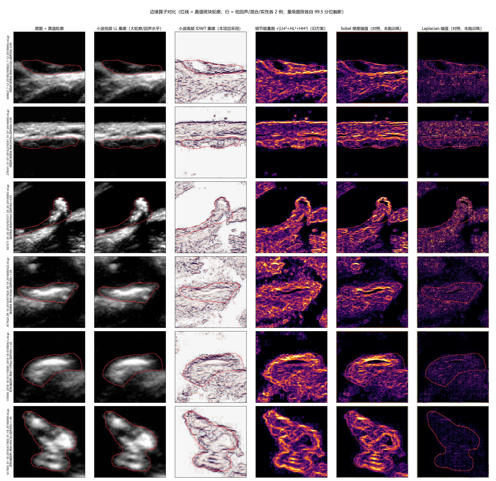

# 边缘融合：用大白话讲清楚

> 这份文档给"不懂深度学习细节但要判断结论靠不靠谱"的人看。
> 目的：看完能回答两个问题——**"边缘图到底是什么东西"** 和 **"那个 +0.018 到底说明什么、能不能信"**。
> 日期：2026-10-27

---

## 0. 一页版

- 我们在做的事：**让分割网络（TransUNet）在看超声图的时候，多看一张"只看轮廓线"的图**。
- 为什么要多看一张：斑块在超声图上边界很糊，光看原图容易把边界画歪。多给网络一张"去掉内容、只留线条"的图，相当于给它一份草稿。
- 现在的证据：**这张草稿确实带原图里没有的信息**（小网络测试：Dice 从 0.489 提到 0.508，提升 1.8 个点，两个数据集都一致）。
- 但这条证据**来自一个小模型**，大模型上到底赚不赚还没答案，要等正式实验（10-28 早上出第一个结果）。

---

## 1. 「边缘图」到底是什么

### 1.1 用滤镜理解

想象一张超声照片上有两样东西：

- **大轮廓**：斑块整体占多大范围、什么形状（低频信息）
- **细节纹理**：斑块边缘那条线在哪里、内部有什么回声（高频信息）

我们的「边缘图」就是一张**把大轮廓彻底擦掉、只留下细节纹理**的图。相当于把照片做了一次"只保留铅笔线条"的处理。

### 1.2 怎么擦的（小波分解 LL 置零）

用的是**小波分解**（Haar 小波），过程像「四格拼图」：

```
原图的一小块 2×2 像素          拆成四份
┌───┬───┐                    LL  ← 左上+右下 的平均值 = 这一小块的整体明暗（低频/大轮廓）
│ a │ b │                 →   HL  ← 水平方向的差异
├───┼───┤                    LH  ← 垂直方向的差异
│ c │ d │                    HH  ← 对角方向的差异
└───┴───┘
```

- `LL` = 低频近似 = 大轮廓
- `HL/LH/HH` = 三个方向的高频细节 = 线条在哪

**做法**：整张图拆完后，把 `LL`（大轮廓）**全部置零**，再把小波逆变换拼回去 → 得到的就是边缘图。

代码在 [networks/wavelet.py](../../networks/wavelet.py) 的 `build_hf_image()`：

```python
ll, details = haar_dwt(xl)              # 拆：拿到大轮廓 + 细节
hf = haar_idwt(torch.zeros_like(ll), details)   # 大轮廓清零，拼回去
```

**为什么这么设计**（老师的意见）：之前我们试过把三个细节子带拼成三通道图，但那样会丢分辨率、出现块状伪影。改成"IDWT 重建一张全分辨率的图"（这是 XNet、GobletNet 的做法），干净。

候选算子的肉眼对比（红线 = 真值斑块轮廓；行 = 低回声/软斑块、混合斑块、实性斑块各 2 例，按回声对比度自动挑选；列 = 原图、小波低频 LL 重建、小波高频 IDWT 重建、旧方案能量图、Sobel、Laplacian）：



图源 [scripts/vis_edge_operators.py](../../scripts/vis_edge_operators.py)（`python scripts/vis_edge_operators.py` 可重算）。图上能直接看到 §2 定量分数的三件事：能量图把「边界 + 强斑点」一起点亮，所以纯边界定位反而最准（命中率 1.63x/2.02x）；小波 IDWT 重建保留的不只是边界、还有内部纹理与回声（1.42x/1.71x，仍稳压 Sobel 的 1.07x/1.17x）；Laplacian 被斑点噪声主导，命中率 0.44x/0.59x 比瞎猜还差。两者目标不同，见上表第 3 条。

### 1.3 送进网络的方式（输入级融合）

最省事的一种接法：**不改网络结构，只把第一层卷积的输入从 3 通道改成 4 通道**。

```
原图 (1×224×224) ──┬── 复制 3 份 ──────────┐
                   │                        ├── concat ──→ 4×224×224 ──→ stem ──→ ...
边缘图 (1×224×224) ─────────────────────────┘
```

预训练权重要特殊处理：原来 stem 的卷积核是 7×7×3×64，改成 7×7×4×64 后，**多出来的那一列权重全部填 0**。这样网络一开始的行为和原封不动（边缘通道完全不起作用），训练过程中它自己决定要不要用。参数量只增加 3136 个（105.2761M → 105.2792M），几乎不花显存。

---

## 2. 诊断 A：四种"找边缘"的方法，哪个靠谱

我们不能一上来就跑 200 epoch 大实验（太贵），所以先做一个**便宜的测试**：拿四种常见方法各算一张边缘图，然后看谁算出来的线，跟医生标注的真实斑块边界对得上。

| 方法 | 通俗解释 |
|---|---|
| 小波高频重建（**我们选的**） | 上面的 1.2，擦掉大轮廓留下细节 |
| Sobel 梯度 | 经典图像处理：看每个像素周围"明暗变化有多快"，变化快的地方是边缘 |
| Laplacian 幅值 | 同上，但用二阶差分，对噪声更敏感 |
| 小波细节能量图 | 不重建整张图，只算"这一小块里有几个细节像素"，做成热力图 |

### 2.1 三个评分指标各是什么意思

| 指标 | 大白话 | 怎么读 |
|---|---|---|
| **边界命中率 ×随机** | 边缘图在"真实边界那条线"上的响应有多密，除以"随便乱猜"时的密度 | **>1 才有意义**。<1 = 比乱猜还差。1.42x = 比乱猜密 42% |
| **分离比** | 边界线上的平均响应 ÷ 边界以外的平均响应 | 越大越干净。2.07 = 线上的响应是线外的 2 倍 |
| **AUROC** | 把所有像素按"边缘图给的分数"排序，真边界上的像素排在多少比例之前 | 0.5 = 完全瞎猜，1.0 = 完美。0.72 = 排在前 72% 的位置能找到真边界 |

### 2.2 结果

| 方法 | SPARC 命中率 | SPARC AUROC | 中南 命中率 | 中南 AUROC |
|---|---|---|---|---|
| 小波高频重建（选用） | **1.42x** | **0.723** | **1.71x** | 0.657 |
| Sobel 梯度 | 1.07x | 0.717 | 1.17x | **0.676** |
| Laplacian 幅值 | **0.44x** | 0.653 | **0.59x** | 0.566 |
| 小波细节能量图 | **1.63x** | **0.759** | **2.02x** | **0.715** |

**怎么读这张表**：

1. **我们选的小波高频重建是成立的**。两个数据集上都明显优于 Sobel 和 Laplacian。
2. **Laplacian 比瞎猜还差**（0.44x / 0.59x，低于 1）——说明超声里的"二阶差分大"往往来自斑点噪声，不是斑块边界。用它做边缘图是错的。
3. **但旧的「高频能量图」在"找边界"这件事上更准**（1.63x / 2.02x、AUROC 0.759 / 0.715 最高）。这不矛盾——小波高频重建保留的是"所有高频结构"（包括纹理、内部回声），能量图只保留"哪里有高频"。两者目标不同。
   → **如果正式实验没效果，第一个要试的就是把第 4 通道换成能量图**，代码只改一行。

---

## 3. 诊断 B：那个 +0.018 到底是什么意思

### 3.1 实验设计

先用**一个小网络**（0.061M 参数，只有正式模型的 1/1700）快速做对比实验，20 个 epoch 就跑完。同样的数据、同样的训练配置，只改「喂给网络几张图」：

| 变体 | 喂什么 |
|---|---|
| `raw` | 只喂原图（1 通道） |
| `raw_hf` | 喂原图 + 边缘图（2 通道） |
| `hf` | 只喂边缘图（1 通道） |

### 3.2 结果

| 数据集 | raw | raw+边缘图 | 只边缘图 | 差值 |
|---|---|---|---|---|
| SPARC（训练 350 / 测试 160） | 0.4893 | **0.5075** | 0.4930 | **+0.0181** |
| 中南（训练 448 / 测试 187） | 0.6861 | **0.7044** | 0.6783 | **+0.0183** |

### 3.3 这说明什么

- **「提升的指标」是 Dice**（分割重叠度，0~1，越大越好，见 §4.1）。SPARC 从 0.4893 提到 0.5075，**提升 1.81 个百分点**；中南从 0.6861 提到 0.7044，**提升 1.83 个百分点**。
- 两个数据集**独立得到几乎一样的增量**（+0.0181 vs +0.0183），这不是偶然噪声。
- **「只边缘图」那一列是最关键的证据**：边缘图单独用，能力（0.4930）已经接近原图单独用（0.4893）。说明边缘图里**确实有原图没有的信息**，不是噪声纹理。两张图合起来最好，说明它们**互补**。

### 3.4 但这条证据有两个必须说清楚的限制

**限制一：模型太小、轮数太少、只跑了一个随机种子。**

正式模型有 105M 参数，是这个小网络的 1700 倍。小网络上的 +0.018，放到大模型上会**大概率被缩小**，因为大模型本来就能从原图里自己学出边缘特征，不需要别人告诉它。

**限制二：测试集是"按图片"算的，不是"按病人"算的。**

同一张切片同时出现在训练集和测试集的情况不存在（官方划分是按病人分的），但统计检验需要**同一批病人**在两组条件下都被测过，才能做配对检验。现在做不到，所以**没有 p 值**，不能声称"显著"。

**限制三：天花板效应。**

正式模型的 Dice 已经 90.49%，距离满分只差 9.5%。在这个位置再提升 1.8% 是极难的；历史上所有尝试过的融合方案（三通道早融合、小波引导注意力、双骨干四级融合）全部落在这个量级以内。

### 3.5 所以现在能说什么、不能说什么

| ✅ 能说 | ❌ 不能说 |
|---|---|
| 「边缘通道携带了原图里没有的信息」 | 「边缘融合能让 Dice 提升 1.8 个点」 |
| 「老师定的小波高频重建算子选得对」 | 「这个方案有显著提升」 |
| 「小网络门槛实验通过，值得跑正式实验」 | 「边缘融合已经是本项目最优方案」 |

正式结论要等队列里的 `e1234_sparc`（单骨干 + 边缘通道，SPARC，200 epoch，取 ep150）跑完，约 **10-28 早上 08:40**，判据是**HD95 下降 ≥ 0.5 mm 且 p < 0.05**（需要同病人配对 + 3 个随机种子）。

---

## 4. 附录：常用指标速查

### 4.1 四项分割指标

| 指标 | 含义 | 方向 | 单位 | 直观解释 |
|---|---|---|---|---|
| **Dice** | 预测区域和真值区域的重叠比例 | 越大越好 | 无量纲（0~1） | 0.9 = 重叠 90%；对边界偏移很敏感 |
| **ASSD** | 平均表面距离 | 越小越好 | **mm** | 两个轮廓的平均偏差距离 |
| **HD95** | 95% 豪斯多夫距离 | 越小越好 | **mm** | 最差的 5% 点被忽略后的最大偏差——**对离群点稳健** |
| **\|ΔArea\|** | 预测面积与真值面积之差的绝对值 | 越小越好 | **mm²** | 有没有"画大了"或"画小了" |

> 重要：本项目已把距离指标**换算成毫米**（用 NIfTI 头里的 spacing，实测 SPARC 约 0.065 mm/px、中南约 0.067 mm/px），不再是像素。10-25 之前的旧数字是像素口径，不可直接比较。

### 4.2 四个模型名词

| 名词 | 含义 |
|---|---|
| **基线 / 单骨干** | 只用一套编码器（TransUNet），原图进、分割出 |
| **双骨干** | 两套编码器：主路吃原图，侧路吃小波的三个方向子带，在 4 个层级交叉融合 |
| **边缘融合（输入级）** | 仍是单骨干，只把 stem 输入从 3 通道变 4 通道，多一张边缘图 |
| **stem** | 编码器的第一层（7×7 卷积），"边缘融合"改的就是它吃几张图 |

### 4.3 一句话记住本轮全部结论

> 边缘图这一招方向是对的、代价极小（只多 3136 个参数）、已落代码并接进队列；
> 现在有"它带额外信息"的证据，但还没有"在大模型上能涨指标"的证据；
> 第一个硬结论 10-28 早上出。
